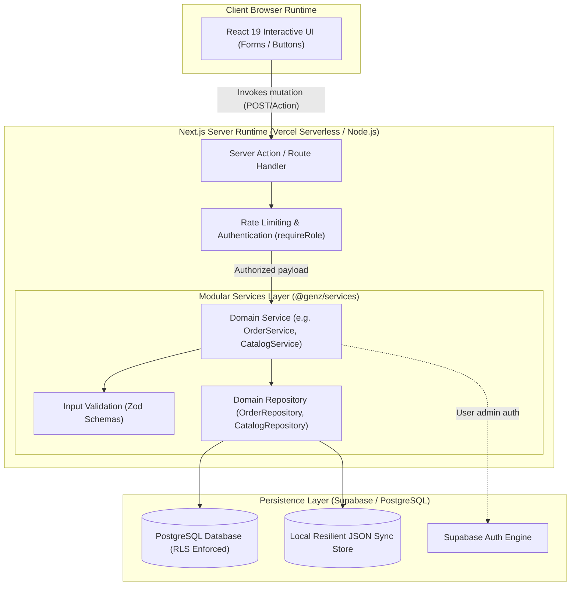

# Modular Backend Services Layer Architecture

## Executive Overview

The GenZ marketplace uses a **Modular Backend Services Layer** integrated directly into the pnpm/Turborepo monorepo. This architecture organizes all domain logic into decoupled, single-responsibility service modules while preserving a unified, single-process deployment runtime.

> **Key Architectural Invariant**: All backend services run inside the existing Next.js App Router server runtime (Server Actions, Route Handlers, React Server Components) on Vercel and utilize the existing Supabase / PostgreSQL persistence infrastructure. No independent microservices, separate Express servers, Docker containers, or Kubernetes clusters are required.

---

## 1. Monorepo Structural Topology

```text
GenZ/
├── apps/
│   ├── web/                     # Buyer marketplace & discovery (Next.js 15, Port 4151)
│   ├── seller/                  # Artisan & maker fulfillment portal (Next.js 15, Port 4252)
│   ├── admin/                   # Platform administration & CRM (Next.js 15, Port 4353)
│   └── operations/              # Operational tooling
│
├── services/                    # Unified Modular Services Layer (@genz/services)
│   ├── auth/                    # Auth provisioning, sessions & RBAC
│   ├── customers/               # Customer profiles, addresses & orders
│   ├── sellers/                 # Artisan onboarding, verification & profiles
│   ├── products/                # Product creation, publishing & query engine
│   ├── pricing/                 # GST slabs, discounts, shipping & commission
│   ├── search/                  # Multi-field sanitized catalog search
│   ├── cart/                    # Cart validation, line items & seller grouping
│   ├── checkout/                # Order placement orchestration
│   ├── payments/                # Razorpay gateway, signature validation & UPI
│   ├── orders/                  # Order lifecycle & state machine transitions
│   ├── stock/                   # Real-time inventory status & threshold checks
│   ├── shipping/                # Logistics partners, dispatch & AWB tracking
│   ├── notifications/           # Transactional emails via Resend
│   └── analytics/               # Business telemetry & event tracking
│
├── packages/                    # Shared Primitives & Platform Tooling
│   ├── database/                # Supabase clients (client, server, admin) & repositories
│   ├── validation/              # Zod schemas (GSTIN, product form, KYC)
│   ├── types/                   # TypeScript domain contracts
│   ├── ui/                      # Shared atomic design system (@genz/ui)
│   ├── utils/                   # Rate limiting, Resend, Vercel analytics
│   └── config/                  # Shared TypeScript configs
│
├── supabase/                    # PostgreSQL migrations & RLS policies
│   └── migrations/
│
└── docs/
    └── architecture/
        └── backend-services.md  # (This document)
```

---

## 2. Target Request Flow Architecture

Every user action flows unidirectionally from the UI presentation layer down to persistence:



---

## 3. Services Inventory & Responsibilities

| Service | Module Export | Core Responsibilities |
| :--- | :--- | :--- |
| **`auth`** | `@genz/services/auth` | Secure password generation, user provisioning in Supabase Auth admin, metadata synchronization, and profile RBAC verification. |
| **`customers`** | `@genz/services/customers` | Customer profile querying, shipping address updates in user metadata, and customer order history. |
| **`sellers`** | `@genz/services/sellers` | Seller signup application ingestion, approval workflow (provisions auth credentials & welcome email), application rejection with audit notes, and intelligent profile fallback resolution (Non-Negotiable Rule 4). |
| **`products`** | `@genz/services/products` | Product creation, updates, publishing status lifecycle, safe slugification, materials parsing, and ownership authorization. |
| **`pricing`** | `@genz/services/pricing` | Subtotal calculation, GST tax slab computation (5%, 12%, 18%), shipping fee thresholds (free above ₹999), paise conversions, and marketplace commission calculations. |
| **`search`** | `@genz/services/search` | Multi-field search querying `name`, `category`, and `description` with wildcard sanitization, category matching, and formatted product outputs. |
| **`cart`** | `@genz/services/cart` | Cart line-item validation, non-negative price enforcement, and multi-artisan seller item partitioning. |
| **`checkout`** | `@genz/services/checkout` | End-to-end checkout orchestration: cart validation, server-side pricing recalculation, order persistence, and asynchronous seller notification dispatching. |
| **`payments`** | `@genz/services/payments` | Razorpay order creation (handles test keys and sandbox simulation), cryptographic HMAC-SHA256 signature verification, and UPI UTR validation. |
| **`orders`** | `@genz/services/orders` | Order creation, query filters (`getAll`, `getSellerOrders`, `getCustomerOrders`), and strict status transitions (`placed` ➔ `processing` ➔ `shipped` ➔ `delivered` / `cancelled`). |
| **`stock`** | `@genz/services/stock` | Stock quantity evaluation (`in_stock`, `low_stock`, `out_of_stock`), threshold checks, and inventory tracking rules. |
| **`shipping`** | `@genz/services/shipping` | Logistics partners management (India Post, Blue Dart, Delhivery, DTDC, Ekart, Shadowfax), dispatch verification, and AWB tracking URL generation. |
| **`notifications`** | `@genz/services/notifications` | Transactional email delivery via Resend, dynamic seller email resolution, and template parameterization. |
| **`analytics`** | `@genz/services/analytics` | Telemetry tracking for domain events (`order_placed`, `seller_application_submitted`, `seller_verified`). |

---

## 4. Strict Dependency & Boundary Rules

1. **Dependency Direction**:
   - `apps/*` ➔ `services/*` ➔ `packages/*`
   - `apps/*` ➔ `packages/*`
   - **Illegal**: `packages/*` or `services/*` importing from `apps/*`.
   - **Illegal**: `services/*` importing React components or UI libraries (`@genz/ui`, `lucide-react`, `next/navigation`).
2. **Public Interfaces Only**: Callers in `apps/` import from `@genz/services/<name>` (e.g. `@genz/services/catalog`), never reaching into deep internal file paths.
3. **No Circular Dependencies**: Services coordinate by importing public service classes or through orchestration services (such as `CheckoutService` invoking `PricingService`, `OrderService`, and `NotificationService`).
4. **No Cross-Service HTTP**: Services are standard TypeScript classes and functions that execute in-memory within the active server process. They never invoke HTTP endpoints on themselves.

---

## 5. Security & Authorization

- **Server Guard (`requireRole`)**: Next.js Server Actions and Route Handlers remain the security gatekeeper, validating user sessions and roles before invoking service methods.
- **Service Verification**: Services independently verify resource ownership (e.g., `OrderService.transitionStatus` verifies that seller users only update orders containing their items, and `CatalogService.verifyProductOwnership` verifies product ownership).
- **Client Sanitization**: All database access and service-role keys remain behind `server-only` barriers, never leaking to browser client bundles.
- **Never Trust Client Calculations**: Client-submitted totals, tax rates, and prices are ignored at checkout; `CheckoutService` recalculates all totals server-side using `PricingService`.

---

## 6. How to Add a New Service

When adding a new domain service (e.g., `services/promotions`):

1. **Create Directory**:
   ```text
   services/promotions/
   ├── index.ts
   ├── promotions.service.ts
   ├── promotions.repository.ts
   ├── promotions.schemas.ts
   ├── promotions.types.ts
   └── __tests__/
       └── promotions.service.spec.ts
   ```
2. **Implement Layers**:
   - Define domain interfaces in `promotions.types.ts`.
   - Define validation in `promotions.schemas.ts`.
   - Implement data operations in `promotions.repository.ts`.
   - Implement use cases and business rules in `promotions.service.ts`.
   - Export public API in `promotions/index.ts`.
3. **Register Export in `services/package.json`**:
   Add `"./promotions": "./promotions/index.ts"` to `exports`.
4. **Add Unit Test**: Co-locate unit tests in `__tests__/promotions.service.spec.ts` and verify with `pnpm test`.

---

## 7. Deployment Implications & Future Extraction Criteria

### Current Vercel Runtime
- **Single Process**: All services compile into the Next.js server chunks on Vercel Serverless Functions.
- **Cold Start & Bundle Size**: By using lightweight, zero-dependency modules and standard TypeScript functions, services add negligible overhead to serverless function bundles.
- **Zero Additional Cost**: No extra servers, databases, or cloud accounts are needed.

### Future Extraction Criteria
Services should remain in this in-process modular architecture unless one of the following criteria is met:
1. **Independent Scaling**: A service experiences compute spikes disproportionate to web traffic (e.g. heavy AI image processing or ML recommendation engines).
2. **Different Runtime Requirements**: A service requires long-running background daemon execution (e.g. continuous WebSocket brokers or heavy persistent queues) exceeding Vercel function timeout limits (15–60s).
3. **Separate Team Ownership**: A team requires isolated CI/CD deploy cycles without deploying frontends.
